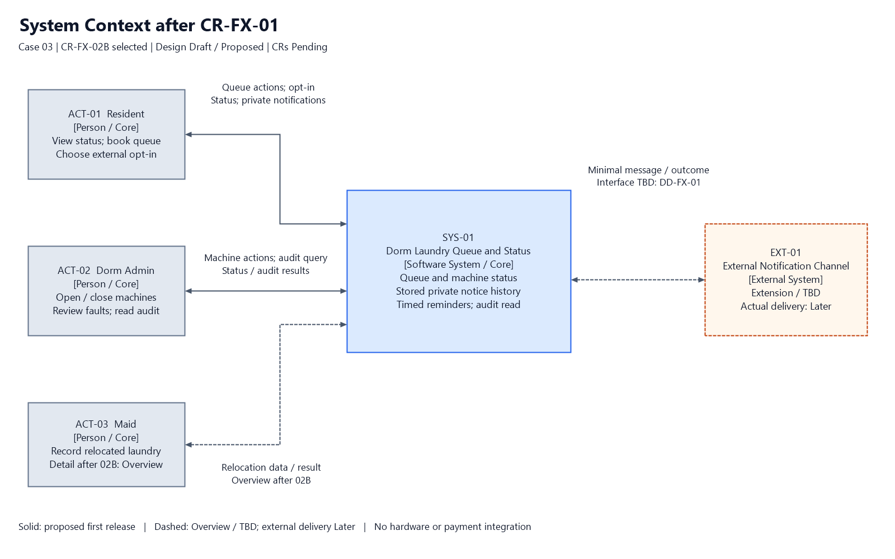
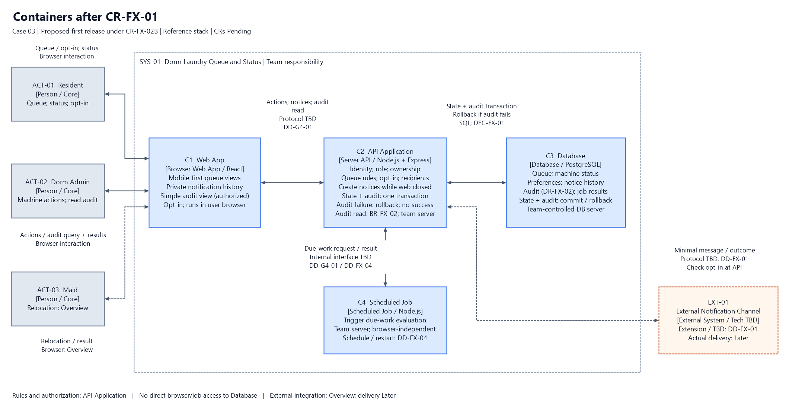

# G4 สถาปัตยกรรมหลัง CR-FX-01 และ CR-FX-02B

ผู้รับผิดชอบตามการแบ่งงาน: ปฐมพร หลีจาง · ปรับร่าง 23 ตุลาคม 2569 · สถานะ Design Draft / Proposed

ร่างแยกสำหรับผู้รวมไฟล์นำลง G4 ใน Word กลาง เลือก CR เสริม **CR-FX-02B** ตามคำสั่งผู้ใช้ ทั้ง CR-FX-01 และ CR-FX-02B ยังเป็น **Pending** ไม่ใช่มติอนุมัติของเจ้าของระบบ

## ฐานอ้างอิง

- SRS: [CASE03-SRS-W07-v1](../docs/07-srs-v1.md), version 1.0-draft / Baseline Candidate ณ commit `b46b207cb148c2730f1f3b68af9989b11f9d12f1` โดยเฉพาะ §2–8
- [ร่าง G3/G5 ของพสิษฐิ์](references/pasit-g3-g5-draft.md): ใช้ชื่อ container, driver D-FX-01–05, Spine SP-FX-01–07 และ DD-FX-01–06 จากร่างนี้
- ตรวจ G1/G2, G3/G5 และ G4 ใน [Word ฉบับรวม](final-exam-group-answer.docx) ณ commit `20bd38f9397059684a531c73b97c2215a8253d8e` โดยอ่านเนื้อหาและตารางจาก OOXML และเทียบกับ [G3/G5 ล่าสุด](pasit-g3-g5-draft.md); ยังไม่ใช่การตรวจ layout ของ Word รอบนี้
- [ผลตรวจ G4 เทียบ G1/G2 และ G3/G5 ล่าสุด](references/g4-review-notes.md) ที่ผู้ใช้แนบ: รายงานว่า G2 ฉบับแก้ไขเพิ่ม FR-FX-03, FR-FX-04, DR-FX-02 และ BR-FX-02 แล้ว จึงใช้ ID และพฤติกรรมตามผลตรวจนี้แทนข้อเสนอรหัส audit เดิมของ G4 ทั้งหมดยัง Proposed ไม่ใช่ baseline Approved รอบนี้ตรวจ ID และข้อความ G2 ฉบับแก้ไขจาก Word ฉบับรวมแล้ว โดยไม่ถือเป็นการอนุมัติ requirement
- [W10 เดิม](../design/10-design-strategy.md) และ [W11 เดิม](../design/11-conceptual-architecture.md) ยังเป็นแม่แบบ จึง Cannot Verify แบบเดิมที่เสร็จสมบูรณ์; ภาพนี้เป็นร่างใหม่ตามข้อสอบ ไม่แก้ไฟล์รายสัปดาห์
- [โจทย์ส่วน กและแม่แบบ](https://github.com/se-rmutl/engse206-lab/tree/main/weeks/week-15-final-exam/exam), [W11 และ stack อ้างอิง](https://github.com/se-rmutl/engse206-lab/tree/main/weeks/week-11-conceptual-architecture): React · Node.js + Express · PostgreSQL และชนิดงานตามเวลา

สำเนา G3/G5 เดิมใน references/ เป็นหลักฐานย้อนหลัง; ใช้ pasit-g3-g5-draft.md และ Word ฉบับรวมบน branch final-exam เป็นฐานตรวจปัจจุบัน ไม่แก้ข้อความในสำเนาอ้างอิงของเพื่อน

### ชื่อร่วมในเอกสารและภาพ

| ID ใน G4 | ชื่อในภาพ | ความหมาย |
|---|---|---|
| ACT-01 | Resident | นักศึกษาหอพัก ตาม SRS §2.2 |
| ACT-02 | Dorm Admin | ผู้ดูแลหอพัก ตาม SRS §2.2; อ่าน audit เมื่อมีสิทธิ์ตาม BR-FX-02 |
| ACT-03 | Maid | แม่บ้าน ตาม SRS §2.2 |
| SYS-01 | Dorm Laundry Queue and Status | ระบบจองคิวและติดตามสถานะเครื่องซักผ้าหอพัก |
| EXT-01 | External Notification Channel | ระบบภายนอก Extension/TBD; ภาพรวม Overview และส่งจริง Later |
| C1 | Web App | เว็บแอปในเบราว์เซอร์ · React |
| C2 | API Application | โปรแกรมฝั่ง server (API) · Node.js + Express |
| C3 | Database | ฐานข้อมูล · PostgreSQL |
| C4 | Scheduled Job | งานตามเวลา · Node.js; วิธีตั้งเวลารอ DD-FX-04 |

ID actor/container เป็นรหัสของร่างนี้ ไม่ใช่ requirement ID ฐาน ช่างเทคนิคเป็น stakeholder ใน Case Card แต่ SRS §2.2 ยังไม่กำหนด flow จึงไม่เพิ่ม actor/integration ของช่างเอง

## 4.1 Context diagram

[Context source](diagrams/context-after.drawio)

มี SYS-01 เพียงหนึ่งกล่อง actor 3 กลุ่ม และ EXT-01 เป็น Extension/TBD ไม่ระบุผู้ให้บริการหรือ protocol เพิ่มรายการแจ้งส่วนตัวในเว็บตาม FR-FX-03/US-FX-02/UC-FX-02/AC-FX-06 และการอ่าน audit แบบง่ายของผู้ดูแลที่มีสิทธิ์ตาม UC-FX-03/AC-FX-09

รายการแจ้งถูกสร้างและเก็บฝั่ง server แม้ผู้ใช้ไม่ได้เปิดเว็บ เจ้าของอ่านย้อนหลังได้แม้ไม่ opt-in ภายนอก เป็นรายการแจ้งในเว็บ **ไม่ใช่ browser push** ภายนอกยังไม่ส่งจริงจนตัดสิน interface เส้นประแม่บ้านคือ Overview หลัง 02B ตามร่าง G3/G5 ระบบยังใช้ simulation ตาม CT-01 ไม่เพิ่ม IoT หรือการเงินนอก SRS §1.3

## 4.2 Container diagram

[Container source](diagrams/container-after.drawio)

เสนอ C1–C3 ตาม stack อ้างอิง และ C4 ชนิดงานตามเวลาเพื่อทำงานได้โดยไม่มี browser เปิด C4 เรียก C2 ประเมินงานถึงเวลา ไม่อ่าน C3 โดยตรง C2 ตรวจสิทธิ์ กฎคิว ผู้รับ และ opt-in; C3 เป็นที่เก็บถาวร รายการแจ้งตาม FR-FX-03 ไม่ขึ้นกับการอนุญาตภายนอก

**การเปลี่ยนสถานะและ audit:** C2 ให้ C3 บันทึกสถานะกับ audit ทุกการเปลี่ยนสถานะคิวหรือเครื่องที่สำเร็จใน **transaction เดียวกัน** ตาม FR-FX-04/DR-FX-02 ถ้า audit ล้มเหลวให้ rollback สถานะกลับค่าเดิม ไม่ยืนยันและไม่สร้างข้อความว่าการเปลี่ยนสถานะใหม่สำเร็จตาม AC-FX-08 การสร้างรายการแจ้งสำเร็จของสถานะใหม่ทำได้หลัง transaction สำเร็จเท่านั้น รายละเอียดป้องกันรายการแจ้งตกหล่น/ส่งซ้ำรอ DD-FX-04 โดยไม่อ้าง exactly-once

**การอ่าน audit:** Dorm Admin ที่มีสิทธิ์ → C1 → C2 ตรวจ BR-FX-02 → C3 → คืนผลอ่านแบบง่ายให้ C1 เป็น Build now ตาม UC-FX-03/AC-FX-09 ปฏิเสธนักศึกษาอ่านและปฏิเสธการแก้/ลบผ่านงานทั่วไป รายงานและค้นหาขั้นสูง Later ไม่เพิ่ม audit container แยก

เส้นทึบคือรุ่นแรกที่เสนอ เส้นประคือ Overview/TBD; EXT-01 อยู่นอกขอบเขตทีม protocol ที่ไม่ระบุใน SRS เป็น TBD ตาม DD-G4-01 และ DD-FX-01/04 ส่วน SQL/transaction ระหว่าง C2–C3 เป็นข้อเสนอใน DEC-FX-01

ค่า 10 นาทีจาก FR-03/BR-02 และเตือนก่อนซักเสร็จ 5 นาทีจาก FR-04 เป็นค่าฐาน ส่วนเวลาเตือนก่อนกำหนดอื่น ระยะเวลาซัก และวิธีทราบ deadline ใหม่ยัง TBD ตาม DD-FX-02/04 ห้ามใช้ 5 นาทีแทนทุกกรณี

## 4.3 ตาราง container เฉพาะแถวใหม่หรือเปลี่ยน

W11 เดิมยังไม่กรอก จึงแสดงทั้ง 4 container ของร่างใหม่ ไม่อ้างว่าเคยมีแบบเดิมที่ตรวจพบแล้ว

| Container | หน้าที่ / requirement | ชนิด · stack | รันที่ไหน · ใครควบคุม | ข้อมูลที่เก็บ | คุยกับและสิ่งที่ส่ง |
|---|---|---|---|---|---|
| C1 Web App | แสดงคิว, opt-in, รายการแจ้งส่วนตัวอ่านย้อนหลังแม้ไม่ opt-in ตาม FR-FX-03/US-FX-02/UC-FX-02/AC-FX-06; หน้าผู้ดูแลอ่าน audit แบบง่ายตาม UC-FX-03/AC-FX-09 | เว็บแอปในเบราว์เซอร์ · React | browser ผู้ใช้; ทีมควบคุมโค้ดที่แจก ผู้ใช้ควบคุมเครื่อง จึงไม่ใช้ C1 ตัดสินสิทธิ์ | ข้อมูลแสดงผลชั่วคราว; ประวัติและ preference ถาวรอยู่ C3 | actor ↔ C1 ↔ C2: คำสั่ง/สถานะ/รายการแจ้งของตน/ผลอ่าน audit ตามสิทธิ์; protocol TBD DD-G4-01 |
| C2 API Application | ตรวจตัวตน/role/ownership, BR-01–04 และ BR-FX-02; สร้างรายการแจ้งฝั่ง server ตาม FR-FX-03; บันทึกสถานะ+audit transaction เดียวตาม FR-FX-04/DR-FX-02; audit ล้มเหลว rollback/ไม่แจ้งสำเร็จตาม AC-FX-08; อนุญาตอ่าน audit เฉพาะผู้มีสิทธิ์และปฏิเสธแก้/ลบผ่านงานทั่วไป | โปรแกรมฝั่ง server (API) · Node.js + Express | server ทีม; Dev/ผู้ดูแลระบบควบคุม; hosting TBD DD-G4-02 | ไม่มีข้อมูลธุรกิจถาวรแยกจาก C3 | C1 คำสั่ง/ผล; C3 อ่านเขียน/transaction; C4 งานถึงเวลา/ผล; EXT-01 ข้อความขั้นต่ำเมื่อ opt-in (Overview) |
| C3 Database | เก็บข้อมูลฐาน SRS §6, preference DR-FX-01, รายการแจ้ง FR-FX-03 และ audit DR-FX-02; สถานะ+audit commit/rollback ร่วมกัน; รองรับอ่าน audit แบบง่ายผ่าน C2 | ฐานข้อมูล · PostgreSQL | server ฐานข้อมูลที่ทีมควบคุม; Dev/ผู้ดูแลระบบจัดสิทธิ์; deployment/backup TBD DD-G4-02 | คิว สถานะเครื่อง ผ้าที่ย้าย Maintenance Log, preferences, notification records, audit และผลประมวลผลงาน; schema/retention ที่ไม่กำหนด TBD DD-FX-05 | C2 เท่านั้นผ่าน SQL/transaction ตามข้อเสนอ; C1/C4/EXT-01 ไม่เชื่อมตรง |
| C4 Scheduled Job | กระตุ้นเตือนตาม FR-04/FR-FX-01 ผ่าน C2 ให้สร้างรายการแจ้ง FR-FX-03 แม้ไม่มีคนเปิดเว็บ; รองรับการประเมินข้ามคิว FR-03 เมื่อยืนยัน flow | งานตามเวลา · Node.js | process บน server ทีม; Dev/ผู้ดูแลระบบควบคุม; trigger/restart TBD DD-FX-04 | ไม่เป็นแหล่งข้อมูลถาวร; งาน/ผลอยู่ C3 ผ่าน C2 | C2 รับคำขอประเมินเวลาและคืนผล; internal interface/สิทธิ์ job TBD DD-G4-01/DD-FX-04 |

## 4.4 NFR → container

| NFR / source | ต้องการอะไร | ผลต่อ container | สถานะ |
|---|---|---|---|
| NFR-01 + BR-04 (ฐาน) | กระดานรวมแสดงเฉพาะรหัสคิว | C2 กรอง response; C1 แสดงเฉพาะข้อมูลที่อนุญาต; C3 แยกข้อมูลภายใน | ออกแบบระดับแนวคิด; ไม่ใช่ผลทดสอบ |
| NFR-FX-01 / AC-FX-04 (ร่าง G2 ผ่านข้อมูลส่งต่อ) | ข้อความภายนอกมีประเภทเหตุการณ์และรหัสคิวจำเป็น ไม่มีชื่อจริง ห้อง เบอร์โทรหรือข้อมูลผู้อื่น | C2 กรองก่อน EXT-01 และตรวจ opt-in ปัจจุบัน; C3 แยกปลายทางจากเนื้อหาข้อความ | field/ช่องทางที่เหลือ TBD DD-FX-01/03/05 |
| NFR-02 (ฐาน) | จองผ่านมือถือภายใน 3 คลิก | C1 แยกหน้าตั้งค่า opt-in/อ่านแจ้งเตือน/อ่าน audit ออกจาก flow จอง; ไม่บังคับ opt-in เพื่อจอง | ออกแบบระดับแนวคิด; นับคลิกจริงรอหน้าจอ |
| NFR-03 (ฐาน) | สถานะหน้าจออัปเดตตรงกันดีเลย์ไม่เกิน 3 วินาที | C2 คืนสถานะที่ commit แล้ว; C1 ไม่แสดงสำเร็จเมื่อ rollback; วิธีอัปเดต TBD DD-G4-01 | ยังไม่ได้ทดสอบ; ไม่ถือเป็น SLA ส่งภายนอก |
| NFR-04 (ฐาน) | อย่างน้อย 50 คนช่วง 18.00–22.00 น. | C2/C3 รับการจอง รายการแจ้งและ audit; C4 ไม่พึ่ง browser; ยังไม่เพิ่ม cache/DB แยก | ต้องทดสอบ workload รวม; ยังไม่มีผลทดสอบ |
| คุณภาพงานเวลาใหม่: FR-FX-01 / CR-FX-01(2) | เตือนโดยไม่มีคนกด; ค่าเวลาและความคลาดเคลื่อนใหม่ TBD | C4 → C2 ตรวจ deadline/สถานะล่าสุด → C3 เก็บรายการแจ้ง FR-FX-03; สร้างได้แม้เว็บปิด | NFR เวลาใหม่ยัง TBD DD-FX-02/04; ไม่สร้างเลข NFR แทน G2 |

## 4.5 Decision cards

### DEC-FX-01 งานตามเวลาและการบันทึกสถานะพร้อม audit — Proposed

**ตัดสินใจ:** เพิ่ม C4 ชนิด scheduled job จาก C1–C3 ใช้ Node.js เรียก C2 ตรวจเงื่อนไข C2 ใช้ C3 PostgreSQL ผ่าน SQL/transaction บันทึกสถานะกับ audit ตาม FR-FX-04/DR-FX-02 ใน transaction เดียว audit ล้มเหลวต้อง rollback และไม่ยืนยัน/แจ้งว่าสถานะใหม่สำเร็จตาม AC-FX-08 หลัง commit จึงสร้างรายการแจ้งของสถานะใหม่ตาม FR-FX-03 ไม่เพิ่ม audit/notification service หรือ broker

**เพราะ:** CR-FX-01(2), FR-03/04 และ D-FX-03 ต้องทำงานได้โดยไม่มีคนเปิดเว็บ; audit ต้องคงไว้ในรุ่นแรกตามข้อเสนอ 02B และ G2 ล่าสุดที่ผลตรวจรายงาน การเขียน audit หลังสถานะ commit แยกกันทำให้เหลือสถานะใหม่โดยไม่มีหลักฐานเมื่อเกิดข้อผิดพลาด

**ทางเลือกที่ไม่เลือก:** browser timer หรือรอ request ผู้ใช้ (ไม่มีตัวกระตุ้นเมื่อเว็บปิด); บันทึกสถานะก่อนแล้ว audit ภายหลัง (ผิด AC-FX-08); เพิ่ม service/ฐานข้อมูล audit แยก (ไม่มี requirement บังคับและเพิ่มภาระ)

**ผลที่ตามมา:** เพิ่ม runtime งานตามเวลาหนึ่งชนิด; C2 ยังคุมกติกาและ C3 commit/rollback ร่วมกัน; ผู้ใช้ได้รับผลล้มเหลวเมื่อบันทึก audit ไม่สำเร็จ; scheduler, restart, กันส่งซ้ำและการสร้างรายการแจ้งหลัง commit รอ DD-FX-04 ไม่อ้างว่าตัด scope แล้วทำทันแน่นอน

### DEC-FX-02 ขอบเขตช่องทางแจ้งเตือนและสิทธิ์อ่านประวัติ — Proposed

**ตัดสินใจ:** คงรายการแจ้งในเว็บ FR-FX-03 และการอ่าน audit แบบง่าย FR-FX-04/BR-FX-02 เป็น Build now ใน C1/C2/C3 ใช้ชุด container เดิม รายการแจ้งสร้างเมื่อเว็บปิดและเจ้าของอ่านย้อนหลังได้แม้ไม่ opt-in ภายนอก ผู้ดูแลอ่าน audit ได้เมื่อ C2 ตรวจสิทธิ์ผ่านตาม UC-FX-03/AC-FX-09 ปฏิเสธนักศึกษาอ่านและแก้/ลบผ่านงานทั่วไป ส่วนรายงาน/ค้นหาขั้นสูง Later; ภายนอก Overview/TBD ส่งจริง Later

**เพราะ:** FR-FX-03/AC-FX-06 แยกรายการในเว็บจาก opt-in ภายนอก; BR-FX-02/AC-FX-09 กำหนดสิทธิ์ audit; CR-FX-01(3), NFR-01 และ BR-04 ต้องลดข้อมูลและตรวจผู้รับ เวลารุ่นแรกที่ลดลงตาม 02B ควรลดงานรองโดยไม่ตัดกติกาสำคัญ

**ทางเลือกที่ไม่เลือก:** ผูกการแจ้งในเว็บกับ opt-in ภายนอก; ใช้ browser push แทนรายการย้อนหลัง; ตัดหน้าอ่าน audit ทุกการเปลี่ยนสถานะคิวหรือเครื่องที่สำเร็จไปพร้อมรายงานขั้นสูง; ตรวจสิทธิ์แค่ใน C1; เดาผู้ให้บริการภายนอก

**ผลที่ตามมา:** หน้าเว็บมีรายการส่วนตัวและหน้าอ่าน audit แบบง่าย แต่ API เป็นผู้ตัดสินสิทธิ์; ภายนอกยังส่งจริงไม่ได้จนตกลง interface; scope และ CR ยังรอผู้มีอำนาจตัดสิน ไม่อ้างอนุมัติแล้ว

## 4.6 เดิน Spine ขั้นใหม่หรือเปลี่ยน

คง SP-FX-01–07 จากพสิษฐิ์ เพิ่มรายละเอียดตามผลตรวจ G2 ล่าสุดและแยกเส้นทางอ่าน audit ประกอบโดยไม่ตั้งเลข Spine ใหม่แทน G3 ทุกแถวยัง Proposed

| ขั้น / ระดับ | เส้นทาง container | กติกาตรวจที่ไหน | Trace |
|---|---|---|---|
| SP-FX-01 ดูสถานะ/จอง — Build now | Resident → C1 → C2 → C3 แล้วคืนผล | C2 ตรวจตัวตน/BR-01 หนึ่งคิวต่อคน; คืนผลจากสถานะที่ commit แล้ว | FR-01/02, BR-01; D-FX-01 |
| SP-FX-02 เปลี่ยนสถานะ — Build now | ผู้มีสิทธิ์ผ่าน C1 หรือ C4 → C2 → C3 | C2 ตรวจ role/ownership/transition; C3 บันทึกสถานะ+audit transaction เดียว; audit ล้มเหลว rollback สถานะเดิม ไม่ตอบหรือแจ้งว่าสถานะใหม่สำเร็จ | FR-03/05, BR-02/03; FR-FX-04/DR-FX-02; US-FX-03/UC-FX-03/AC-FX-07–08 |
| SP-FX-03 สร้างรายการแจ้ง — Build now | C2 → C3 หลังสถานะ commit | C2 เลือกผู้รับที่เกี่ยวข้องและข้อมูลขั้นต่ำ; สร้างรายการใน server แม้ไม่เปิดเว็บและไม่ opt-in ภายนอก; ไม่สร้างแจ้งสำเร็จของ transaction ที่ rollback | FR-04/FR-FX-03; US-FX-02/UC-FX-02/AC-FX-06; CR-FX-01(1) |
| SP-FX-04 เตือนก่อนซักเสร็จ — Build now; เวลาใหม่ Overview | C4 → C2 → C3; C1 อ่านภายหลังผ่าน C2 | C4 กระตุ้นงาน; C2 ตรวจเวลา สถานะล่าสุดและผู้รับ ไม่เตือนคิวที่ยกเลิก; C3 เก็บรายการ FR-FX-03 แม้ไม่มีเว็บเปิดและผู้ใช้ไม่ opt-in ภายนอก | FR-04 เดิม 5 นาที, CT-01, FR-FX-01/03; AC-FX-02/06; DD-FX-02/04 |
| SP-FX-05 เลือก/ถอน opt-in — Build now | Resident → C1 → C2 → C3 | C2 ตรวจเจ้าของบัญชี; preference ภายนอกไม่ตัดสิทธิ์จองหรืออ่านรายการแจ้งในเว็บ | FR-FX-02/03, BR-FX-01, DR-FX-01; UC-FX-01/AC-FX-03/05/06 |
| SP-FX-06 อ่านรายการแจ้งย้อนหลัง — Build now | Resident → C1 → C2 → C3 แล้วคืนรายการ | C2 กรอง ownership; อ่านของตนได้แม้ไม่ opt-in ภายนอก; เป็นรายการในเว็บ ไม่ใช่ browser push | FR-FX-03, US-FX-02/UC-FX-02/AC-FX-06 |
| SP-FX-07 ภายนอก — Overview; ส่งจริง Later | C2 ↔ C3 แล้ว C2 ↔ EXT-01; interface TBD | C2 ตรวจ opt-in ปัจจุบัน ผู้รับ สถานะล่าสุดและข้อมูลขั้นต่ำ; ส่งล้มเหลวไม่ย้อนคิวหรือยืด grace period; retry/fallback TBD | CR-FX-01(3), NFR-FX-01/AC-FX-04; DD-FX-01/03/04 |
| เส้นทางอ่าน audit ประกอบ — Build now | Dorm Admin ที่มีสิทธิ์ → C1 → C2 ตรวจ BR-FX-02 → C3 → C2 → C1 | C2 อนุญาตอ่านแบบง่ายเฉพาะผู้มีสิทธิ์ ปฏิเสธนักศึกษาอ่านและแก้/ลบผ่านงานทั่วไป; C1 ซ่อนเมนูอย่างเดียวไม่เพียงพอ; รายงาน/ค้นหาขั้นสูง Later | FR-FX-04/DR-FX-02/BR-FX-02; US-FX-03/UC-FX-03/AC-FX-09 |

## Open decisions

DD-FX-01–06 ใช้ความหมายของร่าง G3 ส่วน DD-G4-01/02 เป็นข้อเสนอเพิ่มเฉพาะ G4

| ID | เรื่อง / container | ระหว่างรอและสิ่งที่ชัดแล้ว | เจ้าของคำตอบที่เสนอ |
|---|---|---|---|
| DD-FX-01 | ช่องทางภายนอก C2–EXT-01 | FR-FX-03/US-FX-02/UC-FX-02/AC-FX-06 รองรับรายการในเว็บแล้วตามผลตรวจล่าสุด; ช่องทางภายนอก/protocol ยัง TBD และส่งจริง Later | เจ้าของระบบ/ผู้ดูแลหอพัก + Dev |
| DD-FX-02 | กำหนด/เวลาใหม่ C2/C3/C4 | คง 5 นาทีเตือนก่อนซักเสร็จและ 10 นาที grace period; ไม่ใช้แทนค่าใหม่ | เจ้าของระบบ/ผู้ดูแลหอพัก |
| DD-FX-03 | เหตุการณ์ ผู้รับ ข้อมูลข้อความ | C2 กรองผู้รับและข้อมูลขั้นต่ำ; รายการเหตุการณ์เพิ่มเติม/field ภายนอกที่เหลือ TBD | ผู้ดูแลหอพัก + ตัวแทนนักศึกษา |
| DD-FX-04 | C4 รัน/restart/ยกเลิก/กันซ้ำ; งานแจ้งหลัง commit | สถานะ+audit ต้อง transaction เดียวตาม AC-FX-08 ไม่ใช่เรื่องรอเลือก; การสร้างรายการแจ้ง FR-FX-03 ไม่พึ่งเว็บเปิด; กลไกกันตกหล่น/ซ้ำ/ส่งล้มเหลวรอ Dev | Dev เสนอให้เจ้าของระบบพิจารณา |
| DD-FX-05 | schema/retention/field ข้อมูล C2/C3 | มี FR-FX-03 สำหรับเว็บและ FR-FX-04/DR-FX-02/BR-FX-02 สำหรับ audit ตามผลตรวจล่าสุดแล้ว; คงการอ่านแบบง่ายตาม UC-FX-03/AC-FX-09; รายละเอียดที่ requirement ยังไม่ระบุเป็น TBD ไม่เลื่อนสิทธิ์และ atomicity ออกไป | เจ้าของข้อมูล + Dev + วิจิตรศิลป์ |
| DD-FX-06 | ยอมรับ scope/effort ตาม 02B | คง Pending/Proposed; ไม่รับรองว่าทำทันโดยยังไม่ประเมิน; รายงาน/ค้นหาขั้นสูง Later | เจ้าของระบบ/ผู้มีอำนาจที่ต้องยืนยัน + หัวหน้าทีม Dev |
| DD-G4-01 | identity/role, interface C1–C2/C4–C2 และอัปเดตหน้าจอ | C2 ตรวจทุก action รวม job; protocol TBD ไม่เลือก identity provider | Dev + ผู้ดูแลหอพัก |
| DD-G4-02 | deployment/version/runtime | ใช้ stack อ้างอิง; hosting/backup ที่ไม่กำหนด TBD | Dev |

## ส่งต่อ G3/G5 และผู้รวมไฟล์

คง Build now ของกฎคิว สิทธิ์ การเตือนเวลาฐาน รายการแจ้งส่วนตัวที่สร้างได้เมื่อเว็บปิด การเก็บ audit แบบ transaction และการอ่าน audit แบบง่ายของผู้มีสิทธิ์ตาม G2 ล่าสุดที่ผลตรวจรายงาน เลื่อนรายงาน/ค้นหาขั้นสูงและการส่งภายนอกจริงเป็น Later โดยไม่ลบ C4 หรือเพิ่ม audit container

Audit เป็น requirement ใหม่ **Proposed** ใน FR-FX-04/DR-FX-02/BR-FX-02 ไม่ใช่ข้อบังคับฐานเดิม โดย DR-FX-02 ระบุรหัสเหตุการณ์ ประเภทและรหัสคิว/เครื่อง สถานะก่อน/หลัง เวลาระบบ ผู้กระทำอ้างบัญชีหรือเป็นระบบ และเหตุผลเมื่อมี; ไม่เก็บชื่อจริง เลขห้องหรือเนื้อหาข้อความส่วนบุคคลเกินจำเป็น และไม่ใช้รหัส audit ที่ G4 เคยร่างซ้ำอีก ให้ผู้รวมไฟล์ปรับ G3/G5 ล่าสุดให้เชื่อม UC-FX-03/AC-FX-07–09 ด้วยเมื่อเทียบร่วมกัน

## ตรวจงานและสิ่งที่ยังรอ

- [x] มี source .drawio และ PNG ทั้งสองภาพใน workspace และจัดไว้ใน ZIP สำหรับส่ง review รอบนี้
- [x] ตรวจ XML, ข้อมูลรูปทรง/ข้อความ, ขนาด PNG และลิงก์ในชุดงานด้วยสคริปต์; เปิดดูภาพ PNG
- [x] อัปเดต G4 และภาพตามผลตรวจ: เว็บแจ้งย้อนหลัง, audit transaction/rollback และผู้ดูแลอ่าน audit แบบง่าย
- [x] คง Decision cards G4 จำนวน 2 ใบ, Spine ชุดเดิม และ stack อ้างอิง; ไม่แก้งานรายสัปดาห์
- [ ] ผู้รับยืนยันว่าได้รับ ZIP ครบ และเปิด source .drawio ตรวจใน draw.io แล้ว — ไม่ถือว่าผล review ก่อนหน้าตรวจ source แล้ว
- [x] AI ตรวจ ID/ข้อความ G1/G2–G3/G5–G4 จาก Word ฉบับรวม ณ 20bd38f และตรวจ SHA-256 ภาพฝังทั้งสองว่าตรง PNG ในเครื่อง
- [ ] สมาชิกตรวจร่วมกันและเปิด source ในแอป draw.io ตามจริง
- [ ] ปฐมพรอ่าน/ปรับร่างด้วยตนเอง และสมาชิก review ตามจริง; ไม่ติ๊กคำรับรองแทน
- [ ] ผู้รวมไฟล์นำ G4 และ PNG ลง Word กลาง; สมาชิก commit ด้วยบัญชีตนเองและกรอกหลักฐานจริง

PNG สร้างจากรูปทรง/ข้อความชุดเดียวกับ .drawio ด้วยสคริปต์ ไม่ใช่การ export ผ่านแอป draw.io โดยตรง; ยังไม่ได้เปิด source ในแอป draw.io หรือทดสอบระบบจริง หากแก้ source ในแอปต้อง export PNG ให้ตรงก่อนส่ง

ผลตรวจและรายการส่งต่อรอบนี้: [g4-handoff-pasit.md](g4-handoff-pasit.md)
